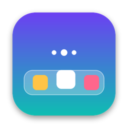
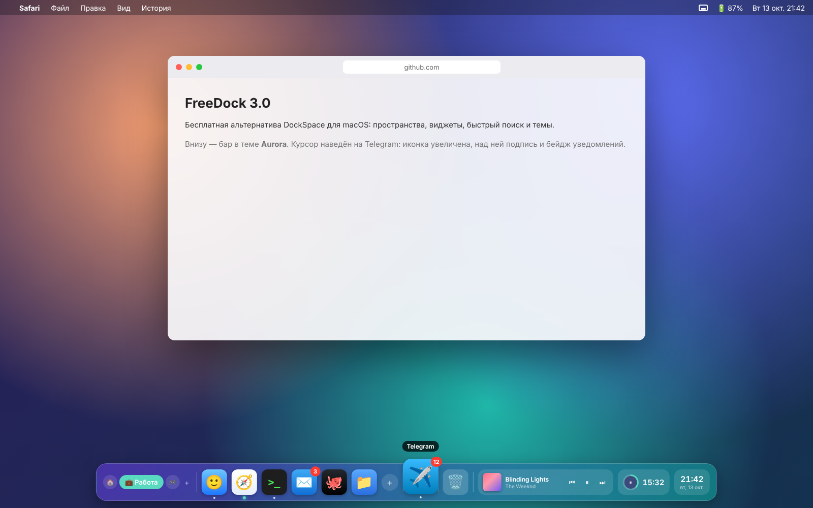

<p align="center"></p>

# FreeDock 3.0

Бесплатная альтернатива DockSpace для macOS: свой Dock с несколькими **пространствами**,
виджетами, быстрым поиском и темами. Без подписок, пробного периода и телеметрии.
Нативное приложение на Swift / SwiftUI / AppKit, без сторонних библиотек.

<p align="center"></p>
<p align="center"><sub>Макет интерфейса (тема Aurora), отрисованный по коду, — не скриншот реального приложения.</sub></p>

## Возможности

### Пространства (главная фишка DockSpace)
- Сколько угодно наборов приложений («Главное», «Работа», «Отдых»…) со своими именами и иконками.
- **Привязка к рабочим столам macOS**: перешёл на «Стол 2» — бар сам переключил набор.
- Переключение: клик по кружку, ⌃⌥1…9, ⌃⌥←/→, прокрутка над баром, строка меню, быстрый поиск.
- При первом запуске «Главное» заполняется приложениями из системного Dock; импорт можно повторить.

### Бар
- Плавающая стеклянная панель поверх окон, на всех рабочих столах и поверх полноэкранных приложений.
- **8 тем**: Стекло, Тёмная, Светлая, Aurora, Electric, Sunset, Graphite, Frost — с регулировкой насыщенности.
- Снизу / сверху / слева / справа; размер 28–96 pt, интервалы, скругление.
- Увеличение при наведении, подписи, прыжок иконки при запуске.
- Индикатор запущенных — точка или линия; **активное приложение подсвечивается** цветом темы.
- **Открытые незакреплённые приложения** показываются после закреплённых (как в Dock) — правый клик → «Закрепить».
- Бейджи уведомлений (красные цифры), как в системном Dock.
- Автоскрытие и переезд на монитор с курсором.

### Иконки
- Приложения, файлы, папки и **ссылки на сайты** (с иконкой самого сайта).
- Перетаскивание: поменять порядок, бросить на кружок другого пространства, бросить в Корзину — убрать из бара.
- **Файл на иконку приложения — открыть в нём**, как в Dock. Файл или ссылка на свободное место — добавить.
- Папки открываются «стопкой» (сетка, новые сверху).
- Правый клик: **список окон** приложения с переходом к нужному, скрыть, завершить (⌥ — принудительно),
  переместить в другое пространство, скопировать ссылку.

### Виджеты
- **Музыка**: Spotify и Apple Music — трек, обложка, пауза, переключение; клик — большой плеер с перемоткой.
- **Часы**: 12/24 ч, секунды; клик — **календарь** с событиями дня из календарей macOS (только чтение).
- **Таймер фокуса**: кольцо прогресса, старт/пауза кликом, длительность 5–90 минут правым кликом, звук в конце.

### Быстрый поиск — ⌃⌥Пробел
- Ищет установленные приложения, всё из бара (во всех пространствах), сайты, пространства и действия.
- Понимает сокращения (`vsc` → Visual Studio Code) и **неправильную раскладку** (`ыфаф` → Safari).
- ↑/↓ выбор, ↩ открыть, **⌘↩ закрепить в баре**, esc закрыть.

### Замена системного Dock
- Одна галочка прячет системный Dock. FreeDock запоминает три его настройки и восстанавливает их
  точно — при выключении, при выходе (по желанию) и даже после сбоя (пункт «Вернуть системный Dock»).
- По умолчанию **выключено** — твой Dock никто не трогает без спроса.

## Горячие клавиши

| Клавиши    | Действие                            |
|------------|-------------------------------------|
| ⌃⌥1 … ⌃⌥9  | переключиться на пространство N     |
| ⌃⌥← / ⌃⌥→  | предыдущее / следующее пространство |
| ⌃⌥Пробел   | быстрый поиск                       |
| ⌃⌥D        | показать / скрыть бар               |
| ⌘,         | настройки (из меню FreeDock)        |

## Установка

```bash
xcode-select --install          # если ещё не стоят Command Line Tools
cd FreeDock
./build.sh install              # соберёт, положит в /Applications и запустит
```

С установленным Xcode собирается **универсальная** версия (Apple Silicon + Intel), с одними
Command Line Tools — под твой процессор. После пуша в GitHub готовую сборку можно скачать
во вкладке **Actions** → **Build** → артефакт `FreeDock` (при первом запуске: правый клик → «Открыть»).

Требуется macOS 13 Ventura или новее.

## Разрешения (всё по желанию)

| Разрешение | Для чего |
|---|---|
| Универсальный доступ | бейджи уведомлений, список окон в меню |
| Автоматизация → Spotify / Music | виджет музыки |
| Автоматизация → Finder | «Очистить Корзину» |
| Календари | события в календаре у часов |

Без них всё остальное работает.

## Если что-то пошло не так

- Настройки: `~/Library/Application Support/FreeDock/config.json` — удали, чтобы сбросить всё.
- Вернуть системный Dock вручную:
  `defaults delete com.apple.dock autohide-delay; defaults delete com.apple.dock autohide-time-modifier; killall Dock`
- Иконка приложения рисуется скриптом `scripts/make_icon.py` (нужен Pillow), готовая лежит в `Resources/`.
