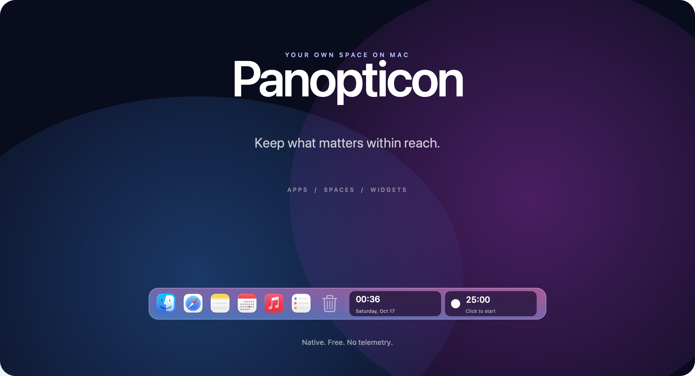
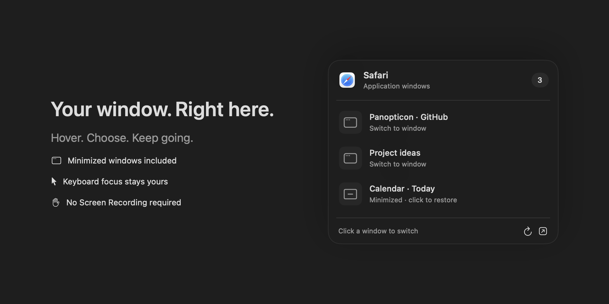
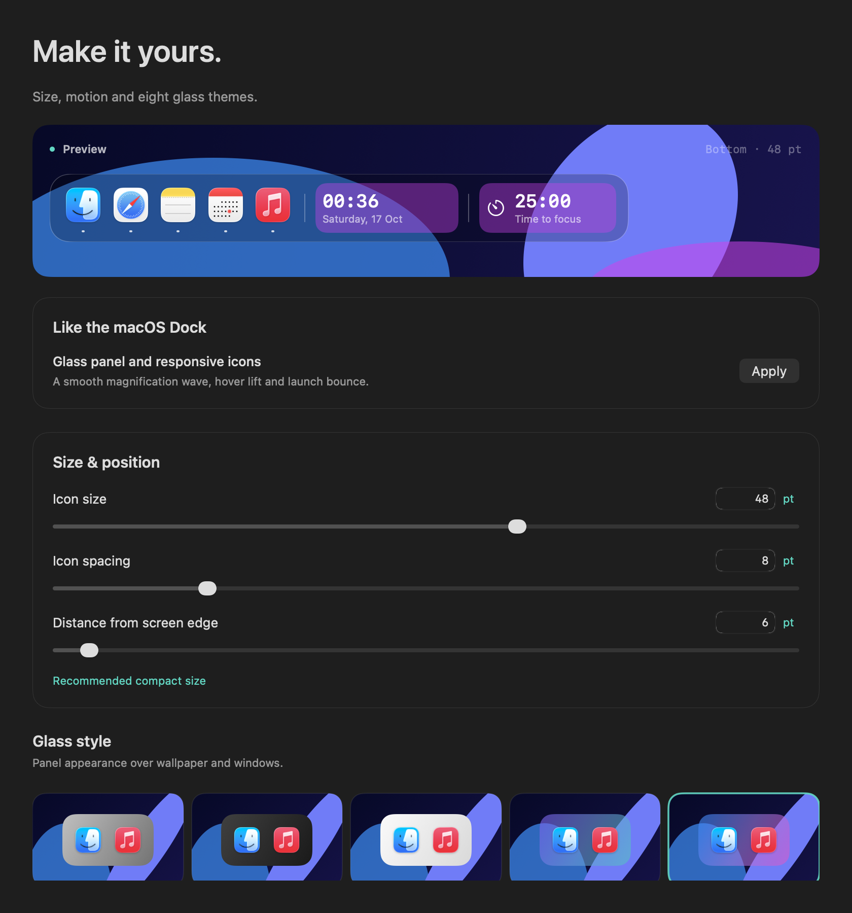
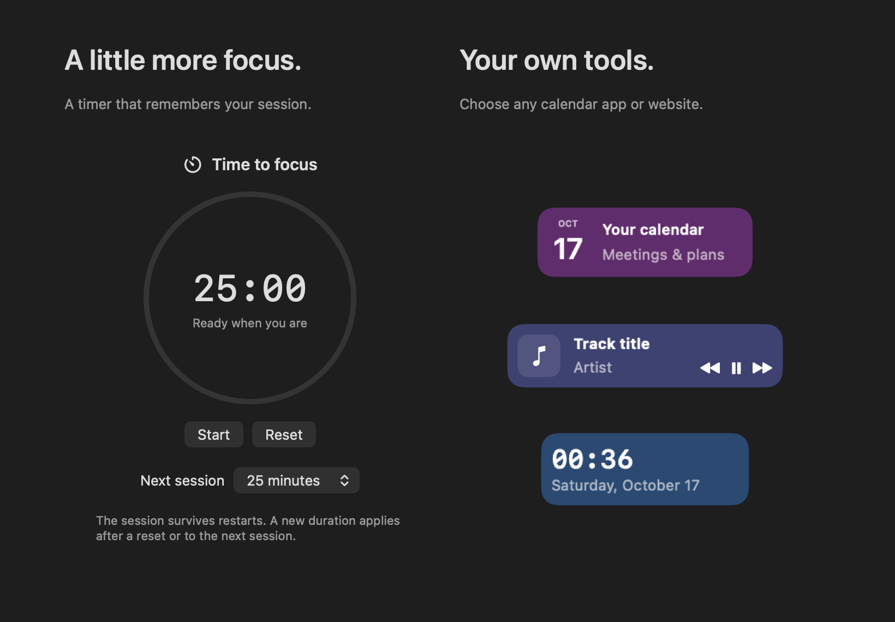

# Your desktop. Your rhythm.

A native app panel for the things you open, the spaces you work in, and the moments in between.

**macOS 13+** · **Apple Silicon & Intel** · **Swift + AppKit** · **MIT**

[English](README.md) · [Russian](README.ru.md) · [User guide](docs/USAGE.md) · [Release readiness](docs/RELEASE.md)

---

## A quieter way to work

Panopticon keeps apps, folders and useful widgets within reach. A smooth magnification
wave follows the pointer; auto-hide gives the desktop back when you move away.
No subscription, required account, telemetry or third-party libraries.

| Make room | Keep your flow | Make it yours |
|:---|:---|:---|
| Independent spaces for work and personal layouts | Pin once; apps stay after you quit them | Eight glass themes, four edges and two widget slots |
| Collections, folders, files and website shortcuts | Search with keyboard navigation and layout correction | Icon size, spacing, lift, glow and magnification |
| Optional system Dock replacement with recovery | A focus session that survives restarts | English, Russian, light, dark or system appearance |

## Start here

[**Download the latest release →**](https://github.com/anonymmized/Panopticon/releases/latest)

1. Open the release page and download the **universal DMG** from Assets.
2. Open the disk image and drag **Panopticon** into **Applications**.
3. Launch it from Applications. If macOS blocks the first launch, try opening it once,
   then choose **System Settings → Privacy & Security → Open Anyway** and confirm.

One download supports **Apple Silicon and Intel**, macOS 13+. No Xcode or terminal is needed.
The current package is distributed without Apple notarization. The download button points
at the latest published release; the owner must publish it before the asset is available.

On first launch, choose a screen edge, import your macOS Dock apps and select widgets.
Calendar, player control and Accessibility connections are optional.

1. **Bring your apps.** Settings → Apps → Add from macOS Dock. Importing adds missing
   apps while preserving your current order. Quitting a pinned app keeps its icon.
2. **Choose your space.** Give work, study or personal time its own layout. Drag items
   onto a space symbol to move them; originals remain on disk.
3. **Find your look.** Adjust Appearance, then pick up to two widgets. Full animations
   enables hover magnification and launch bounce. Follow macOS respects Reduce Motion.

## The right window, within reach

Hover over a running app to see its windows. Click to switch directly to a window,
including one that is minimized. Hovering leaves keyboard focus in your current app;
moving into the list keeps the Dock open. Enable Accessibility with the explicit button.
No Screen Recording permission is needed. Individual browser tabs remain in the browser.

## A panel that feels at home

Fine-tune size, spacing, transparency and motion without restarting. Semantic surfaces
keep labels readable; Reduce Transparency and Increase Contrast have dedicated fallbacks.
The panel leaves keyboard focus with your current app, and transparent margins pass clicks through.

## Small tools, useful every day

- **Focus:** start, pause, resume and reset. Changing the next duration preserves a paused session.
- **Calendar:** browse the month and choose any calendar app or website to open.
  Event access comes separately from calendars connected to macOS.
- **Music:** Spotify and Apple Music, with track information and playback controls.
  Connect control explicitly; browser playback is not supported.
- **Clock:** compact or detailed, 12 or 24 hours, with optional seconds.

Images are rendered from the actual app components using disposable demonstration data.
They contain no personal calendar events, document names or accounts.

## Keyboard first, when you want it

| Shortcut | Action |
|:---|:---|
| `Control` + `Option` + `Space` | Open search; configurable |
| `Control` + `Option` + `1…9` | Select a space |
| `Control` + `Option` + `← / →` | Previous / next space |
| `Control` + `Option` + `D` | Show / hide the panel |
| `Escape` | Close search |

## One Dock, with a way back

Enable **Replace system Dock** in Settings → Behavior & displays. Panopticon saves
and restores the original visibility settings. The native pinned app list is retained.
**Restore system Dock** remains available in Settings and the menu bar; normal exit
restores it too. Crash recovery keeps the backup until restoration succeeds.

**Mission Control uses the macOS Dock.** Panopticon hides during overview to avoid
overlap. A complete replacement inside Mission Control is not implemented.

Auto-hide responds to a brief hover at the chosen edge. Ordinary clicks, opening
Settings and background updates do not summon a hidden panel.

## Updates and Homebrew

Quit Panopticon from its menu-bar icon, download the [latest release](https://github.com/anonymmized/Panopticon/releases/latest)
and replace the app in Applications. Spaces, pins and preferences are preserved.
There is no automatic in-app updater.

A custom Homebrew tap can be generated from the verified DMG. It becomes usable after
the owner publishes the release and a separate tap; Panopticon is not currently listed
in the official Homebrew catalog. See [publication](docs/RELEASE.md).
Source builds and checks are documented in [Development](docs/DEVELOPMENT.md).

<strong>Explore the project</strong>

- [User guide](docs/USAGE.md) — daily use, widgets, folders and recovery
- [Privacy](docs/PRIVACY.md) — local data and optional permissions
- [Architecture](docs/ARCHITECTURE.md) — model, services and contracts
- [Development](docs/DEVELOPMENT.md) — builds, tests and reproducible screenshots
- [Localization](docs/LOCALIZATION.md) — catalogs and language checks
- [Design system](design/README.md) — semantic colors and motion
- [Validation](docs/VALIDATION.md) — what was actually checked
- [Release readiness](docs/RELEASE.md) — remaining release gates

---

Built for macOS. Yours to use, inspect and improve. [MIT license](LICENSE).

