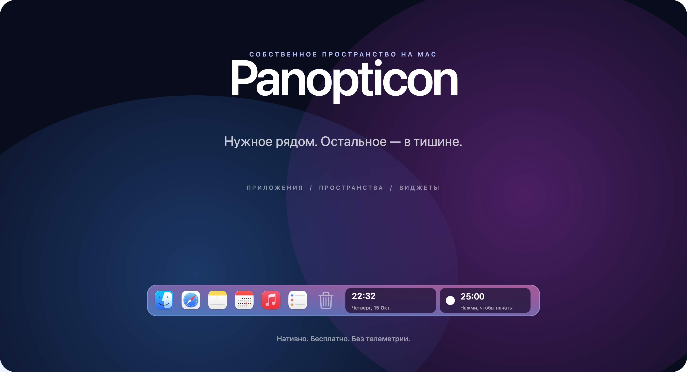
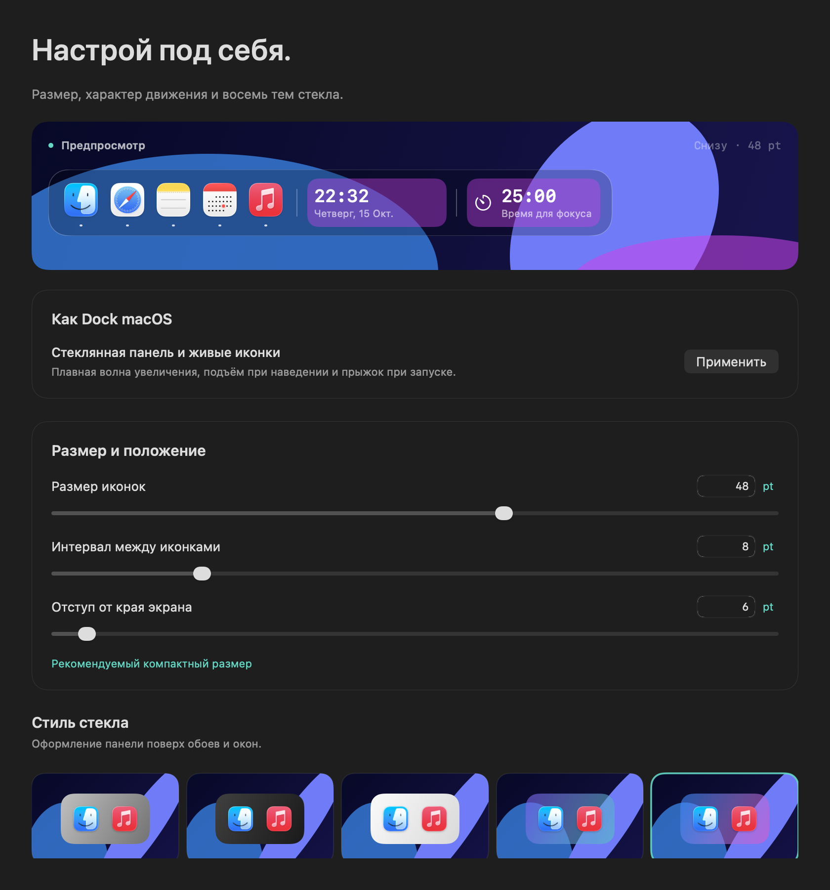
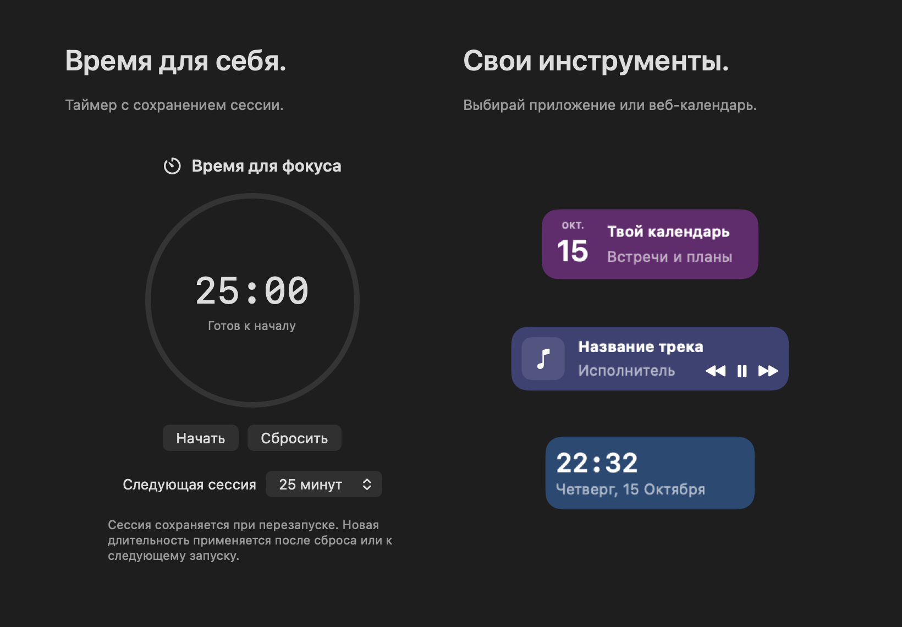

<div align="center">



# Твой рабочий стол. Твой ритм.

Нативная панель для приложений, рабочих пространств и небольших ежедневных дел.

**macOS 13+** · **Apple Silicon и Intel** · **Swift + AppKit** · **MIT**

[English](README.md) · [Русский](README.ru.md) · [Руководство](docs/USAGE.ru.md) · [Готовность к выпуску](docs/RELEASE.ru.md)

</div>

---

## Больше места для своего

Panopticon держит приложения, папки и полезные виджеты рядом. Плавная волна увеличения
следует за указателем; когда он уходит, панель освобождает рабочий стол.
Без подписки, обязательной учётной записи, телеметрии и сторонних библиотек.

| Больше пространства | Меньше отвлечений | По твоему вкусу |
|:---|:---|:---|
| Отдельные наборы для работы и личных дел | Закреплённые приложения остаются после выхода | Восемь тем стекла, четыре края и два места для виджетов |
| Коллекции, папки, файлы и сайты | Поиск с клавиатуры и исправлением раскладки | Размер, интервалы, подъём, подсветка и увеличение |
| Замена системного Dock с восстановлением | Таймер сохраняет сессию при перезапуске | Русский, английский, светлое, тёмное или системное оформление |

## С чего начать

**Версия 1.0 проходит локальную проверку кандидата на выпуск.** Публичный DMG пока
не опубликован. Проверки и ограничения перечислены в [готовности к выпуску](docs/RELEASE.ru.md).

Для сборки нужны Xcode или Command Line Tools со Swift 5.9+:

```sh
./build.sh
open build/Panopticon.app
```

При первом запуске выбери край экрана, перенеси приложения из Dock macOS и настрой
виджеты. Подключение календаря, плеера и Универсального доступа необязательно.

1. **Перенеси приложения.** Настройки → Приложения → Добавить из Dock macOS. Импорт
   дополняет набор, сохраняя твой порядок. Выход из закреплённого приложения не убирает иконку.
2. **Раздели задачи.** Создай наборы для работы, учёбы и личных дел. Переноси элементы
   на символ нужного пространства; исходные файлы остаются на диске.
3. **Найди свой вид.** Настрой оформление и выбери до двух виджетов. Полные анимации
   включают увеличение и прыжки; режим «Как в macOS» учитывает уменьшение движения.

## Знакомая панель, свои настройки



Размер, интервалы, прозрачность и движение меняются без перезапуска. Семантические
поверхности сохраняют читаемость; уменьшение прозрачности и повышение контрастности
учтены отдельно. Панель не забирает фокус клавиатуры, а прозрачные поля пропускают клики.

## Маленькие инструменты на каждый день



- **Фокус:** старт, пауза, продолжение и сброс. Выбор следующей длительности сохраняет паузу.
- **Календарь:** обзор месяца и выбор любого приложения или сайта для открытия.
  События отдельно поступают из календарей, подключённых к macOS.
- **Музыка:** Spotify и Apple Music, данные трека и управление воспроизведением.
  Доступ подключается вручную; музыка из браузера не поддерживается.
- **Часы:** компактный или подробный вид, 12 или 24 часа, секунды по желанию.

Изображения созданы из настоящих компонентов приложения с отдельными демонстрационными
настройками. Личных событий, документов и учётных записей на них нет.

## Можно с клавиатуры

| Сочетание | Действие |
|:---|:---|
| `Control` + `Option` + `Space` | Открыть поиск; можно изменить |
| `Control` + `Option` + `1…9` | Выбрать пространство |
| `Control` + `Option` + `← / →` | Предыдущее / следующее пространство |
| `Control` + `Option` + `D` | Показать / скрыть панель |
| `Escape` | Закрыть поиск |

## Один Dock с возможностью вернуться

Включи **Заменить системный Dock** в настройках поведения. Panopticon сохраняет исходные
настройки видимости и восстанавливает их. Список закреплённых приложений macOS остаётся
на месте. **Вернуть системный Dock** доступно в настройках и строке меню; обычный выход
также восстанавливает его. После сбоя резервная копия хранится до успешного восстановления.

**В Mission Control используется системный Dock.** Panopticon скрывается в обзоре окон,
чтобы панели не накладывались. Полная замена внутри Mission Control не реализована.

Автоскрытие реагирует на короткое наведение к выбранному краю. Обычные клики, открытие
настроек и фоновые обновления не вызывают скрытую панель.

## Собрать, проверить, обновить

```sh
./scripts/check_release.sh
ARCH=universal ./build.sh
./scripts/make_dmg.sh --skip-build
./scripts/verify_distribution.sh build/Panopticon-1.0.0-universal.dmg
```

Перед обновлением заверши установленное приложение и запусти `./scripts/install_app.sh`.
Установщик проверяет ZIP-копию и откатывает неудачную замену. Настройки сохраняют
существующий идентификатор. При смене подписи сборки macOS может повторно запросить
подтверждение разрешений.

Локальные сборки подписываются ad-hoc, если не указан Developer ID. Это не нотариализация
Apple. Подписанные пакеты и отдельный этап публикации описаны в [распространении](docs/DISTRIBUTION.ru.md).

<details>
<summary><strong>Подробнее о проекте</strong></summary>

- [Руководство](docs/USAGE.ru.md) — ежедневная работа, виджеты, папки и восстановление
- [Приватность](docs/PRIVACY.ru.md) — локальные данные и необязательные разрешения
- [Архитектура](docs/ARCHITECTURE.ru.md) — модель, сервисы и контракты
- [Разработка](docs/DEVELOPMENT.ru.md) — сборки, тесты и обновление изображений
- [Локализация](docs/LOCALIZATION.ru.md) — каталоги и проверки языков
- [Дизайн-система](design/README.ru.md) — семантические цвета и движение
- [Проверка](docs/VALIDATION.ru.md) — что действительно протестировано
- [Готовность к выпуску](docs/RELEASE.ru.md) — оставшиеся условия публикации

</details>

---

<div align="center">

Для macOS. Можно пользоваться, изучать и улучшать. [Лицензия MIT](LICENSE).

</div>
